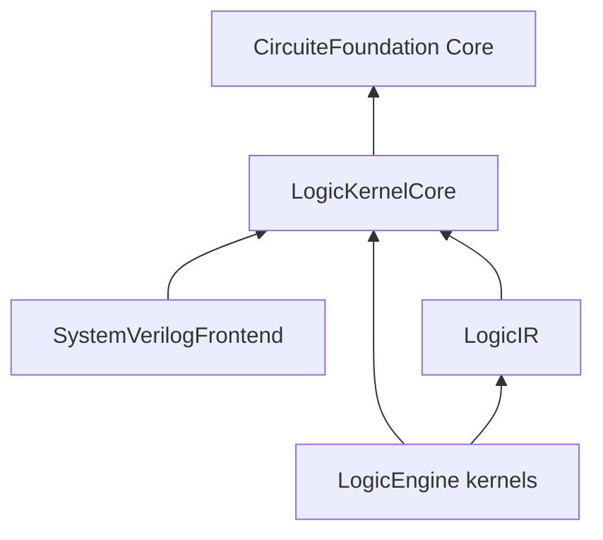

# LogicDesign Design

## Purpose and Scope

Canonical digital design, dataflow/process graph, SystemVerilog frontend and power-intent contracts. Parent: [LSI system](../DESIGN.md). Child module contracts are indexed in Related Designs.

## Responsibilities and Boundaries

This package owns the schemas and engine protocols listed in its public products. It must remain usable without UI state and without the Xcircuite runtime.

`LogicDataflowDesign` is external-independent. It owns typed SSA operations, values, process state, channel
transport policy and validation, but no XLS syntax or runtime behavior. XLS spelling and textual parsing belong
to `EDAInteroperability/XLSInteroperability`, whose dependency points toward this package.

## Non-responsibilities

- Functional simulation
- Logic optimization or technology mapping
- Timing analysis

## Architecture

```text
standard artifacts / canonical references
                 ↓
LogicDesign protocols and result schemas
                 ↓
native or external-tool backends
                 ↓
Xcircuite composition and stage execution
                 ↓
DesignFlowKernel and .xcircuite artifacts
```

Backends may depend on lower-level data packages. This package must never import `Xcircuite` or `circuit-studio`.

## Contracts and Invariants

Kernel availability, corpus validation, oracle correlation, process-scoped qualification and release approval are distinct states. The package reports capabilities, blocked semantics, validation checks and evidence boundaries. ToolQualification owns tool-trust qualification, while Xcircuite applies flow policy and ReleaseEngine owns release authorization.

## Artifact requirements

All outputs are immutable run artifacts with format, digest, producer metadata and the input design/PDK revision needed to reproduce the result.

## Portable Kernel Contract Ownership

The approved synthesis redesign places `LogicKernelCore` in this package. It owns
run-local cumulative resource accounting, typed kernel failures and the synchronous
run-control requirement. Both the frontend and LogicEngine depend downward on it.
It depends only on CircuiteFoundation Core and the Swift standard library. This
corrects the proposed frontend-to-LogicEngineCore package cycle; LogicDesign must
not depend on LogicEngine. Domain values remain owned by LogicIR.



The normative lower contract is [LogicKernelCore](Sources/LogicKernelCore/DESIGN.md).
Legacy Foundation/serialization dependencies are being migrated and are not yet
portable-target evidence. New callable contracts are verified before being reported
as implemented. The task's only progress record is [PROGRESS.md](../PROGRESS.md).

The two verification executables provision a 4 MiB WASM linear-memory stack for
their debug frontend profile (maximum nesting 100). The SDK's default 64 KiB
stack fails the composed program path; disassembly measured 15,520-byte lvalue
and 13,488-byte statement frames in this exact debug artifact. Stack provisioning
belongs to the embedding executable, independently of managed heap admission.
The Node verification host separately provisions a 4 MiB execution stack; its
default stack rejects 94 nested blocks even with the linear-memory stack enlarged.
The profile must execute deep accepted syntax and reject a smaller nesting limit
on each target. These linker settings do not propagate into library products.
See [.verification/logic-program-elaboration](.verification/logic-program-elaboration)
for raw failed/default-stack and explicitly provisioned runtime evidence.

## Portable IR and Host Serialization Boundary

[LogicIR](Sources/LogicIR/DESIGN.md) owns portable values and validation.
[LogicDesignSerialization](Sources/LogicDesignSerialization/DESIGN.md) owns explicit
host coding, byte/digest conversion and standard structural-netlist I/O. Existing
mutable RTL/Gate parse drafts do not establish elaborated, lowered or mapped-stage
invariants. Consumers that serialize these values explicitly import the host product. The
legacy frontend host execution surface still imports it during consumer migration;
new synchronous frontend and calculation kernels must not depend on it.

## Related Designs

| Design | Relationship | Contract Used | Summary | Cautions |
|---|---|---|---|---|
| [LSI](../DESIGN.md) | parent | system composition | independent package | raw evidence is not approval |
| [LogicKernelCore](Sources/LogicKernelCore/DESIGN.md) | child | shared context | portable invocation control | no upward engine dependency |
| [SystemVerilogFrontend](Sources/SystemVerilogFrontend/DESIGN.md) | child | portable source processing | resolved source elaboration | accepted synthesis profile is explicit |
| [LogicDesign host module](Sources/LogicDesign/DESIGN.md) | child | source acquisition and host execution | legacy migration surface | draft success is not synthesis proof |
| [LogicIR](Sources/LogicIR/DESIGN.md) | child | draft and validated values | circuit meaning | draft validation is not proof |
| [LogicDesignSerialization](Sources/LogicDesignSerialization/DESIGN.md) | child | host encoding and decoding | byte boundary | decode validated graphs through builders |

The [SystemVerilogFrontend](Sources/SystemVerilogFrontend/DESIGN.md) owns portable
source processing. Legacy draft parsing and asynchronous execution move to the
[LogicDesign host module](Sources/LogicDesign/DESIGN.md). Their existing
[interface contract](INTERFACES.md) remains a draft contract, not resolved RTL.
PowerIntent retains its host dependency boundary.

## Verification and Change Impact

LogicDesignTests own parser fixtures, legacy byte correlation and host codec
admission. LogicKernelCoreTests own invocation control. Portable probe executables
exercise lower contracts on Native, WASM and Embedded WASM. Evidence is retained
in `.verification/logic-kernel-core` and `.verification/logic-ir`; its scope does
not establish synthesis, symbolic proof, process qualification or release approval.
Host products that persist LogicIR values must explicitly depend on
LogicDesignSerialization when adopting this package revision. That dependency
must never be propagated to portable calculation targets.

## Public dependency floor candidate

See [PUBLIC_FLOOR_MIGRATION.md](PUBLIC_FLOOR_MIGRATION.md) for the exact source boundary,
public dependency, retained products, source migration and qualification limits.
This isolated candidate is prepared for verification, not a whole-package qualification claim.
