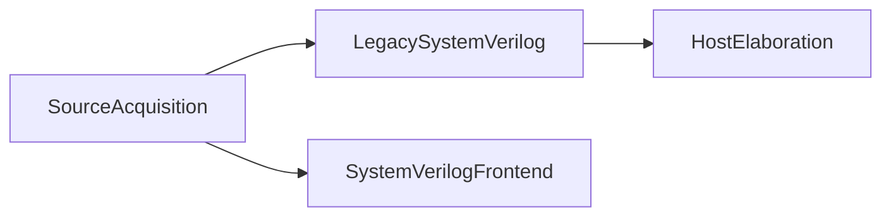

# LogicDesign host module

## Purpose and Scope

Host composition and legacy migration surface. Parent: [LogicDesign package](../../DESIGN.md).
Children: [SourceAcquisition](SourceAcquisition/DESIGN.md),
[LegacySystemVerilog](LegacySystemVerilog/DESIGN.md), [HostElaboration](HostElaboration/DESIGN.md).
Existing capability/oracle composition remains at this module root.

## Responsibilities and Boundaries

Own source acquisition, legacy host DTOs/Engine execution and public composition.
Portable parsing and circuit semantics are owned by lower modules.

## Related Designs

| Design | Relationship | Contract Used | Summary | Cautions |
|---|---|---|---|---|
| [LogicDesign package](../../DESIGN.md) | parent | module composition | package owner | host only |
| [SystemVerilogFrontend](../SystemVerilogFrontend/DESIGN.md) | depends on | portable source processing | replacement frontend | no reverse dependency |

## Architecture

## Contracts and Invariants

Legacy source/parser/execution types are exported from this host module during
migration. New portable frontend never imports Foundation, serialization or this module.

## Verification and Change Impact

Existing host parser/API/CLI tests own compatibility; portable frontend tests own
the new source and language admission boundaries. Consumer imports migrate with
public package dependency adoption.
