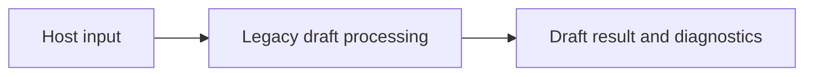

# HostElaboration

## Purpose and Scope

Legacy asynchronous elaboration requests and execution. Parent: [LogicDesign host module](../DESIGN.md). No children.

## Responsibilities and Boundaries

Own the existing host-only migration surface. These legacy values do not establish
new resolved RTL or synthesis invariants. Native portable elaboration replaces the
old draft path before the synthesis runtime migration completes.

## Related Designs

| Design | Relationship | Contract Used | Summary | Cautions |
|---|---|---|---|---|
| [LogicDesign host module](../DESIGN.md) | parent | host composition | containing module | legacy draft contract |
| [LegacySystemVerilog](../LegacySystemVerilog/DESIGN.md) | depends on | legacy source/parser DTOs | host draft processing | not resolved RTL |
| [SourceAcquisition](../SourceAcquisition/DESIGN.md) | depends on | provider and include resolution | host source intake | explicit I/O failure |
| [LogicIR](../../LogicIR/DESIGN.md) | depends on | mutable parse drafts | old input/output | never treat as ElaboratedRTL |
| [LogicDesignSerialization](../../LogicDesignSerialization/DESIGN.md) | depends on | source hashing and host coding | host boundary | no portable dependency |

## Architecture

## Contracts and Invariants

Existing draft behavior and typed host failures remain available in the LogicDesign
host product. The SystemVerilogFrontend portable product no longer exports these
host types. Consumer migration must import LogicDesign for legacy execution.

## Verification and Change Impact

Existing SystemVerilogFrontendTests, EngineTests and FixtureCorpusTests preserve
host draft behavior. New portable lexical and elaboration tests own the replacement
contracts. Consumers must not upgrade legacy results to functional proof evidence.

## State, Ownership, and Lifecycle

Legacy DTOs and parser tables are invocation-local Swift values. Provider
configuration is a copied Sendable value; injected collaborators conform to
Sendable protocols. No mutable reference owner or target synchronization branch
is added by relocation. Host Engine returns a result rather than a stream.

## Failure, Concurrency, and Constraints

Existing host exceptions/diagnostics remain the legacy failure contract. Source
acquisition and include resolution perform synchronous I/O; they are not portable
kernel operations and do not yet implement the new bounded exact-artifact runtime.
The new source-bundle API is independently bounded. Full runtime intake, source
cause retention and cancellation belong to subsequent migration work.
