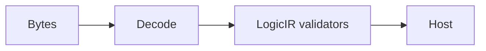

# Codec

## Purpose and Scope

Snapshot/digest and standard structural-netlist codecs. Parent: [LogicDesignSerialization](../DESIGN.md). No children.

## Responsibilities and Boundaries

Own the responsibility identified in Purpose and Scope. Public assumptions and
guarantees are defined once in Contracts and Invariants below.

## Related Designs

| Design | Relationship | Contract Used | Summary | Cautions |
|---|---|---|---|---|
| [LogicDesignSerialization](../DESIGN.md) | parent | composition and ownership | containing design | preserve dependency direction |

## Architecture

## Contracts and Invariants

Own host byte conversion, content digest and schema admission. Decoder failures and semantic failures remain explicit. Raw legacy RTL is a parse representation, not a validated synthesis stage.

## Verification and Change Impact

[LogicDesignTests](../../../Tests/LogicDesignTests) own exact source and snapshot checks. The stage-specific IR codec is added with its validated owners.

The schema-v1 `BitLogicDesignCodec` records two-state nodes, flat connections,
explicit state controls, canonical entity IDs and exact origins. Decode requires
an invocation context and reconstructs through the same consuming builder used
by lowering. No Codable conformance permits publishing a graph without admission.
Input bytes are charged as expansion work before Foundation decoding. Host decoder
allocation/byte-stream limits belong to the host read session; managed portable
table/workspace allocation remains budgeted by BitGraph. Legacy snapshot schema-v1
remains a draft format until the schema-v2 runtime migration; it conveys no new
functional proof authority.
