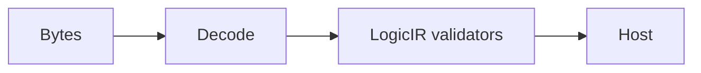

# Codec

## Purpose and Scope

Snapshot/digest and standard structural-netlist codecs. Parent: [LogicDesignSerialization](../DESIGN.md). No children.

## Responsibilities and Boundaries

Own the responsibility identified in Purpose and Scope. Public assumptions and
guarantees are defined once in Contracts and Invariants below.

## Related Designs

| Design | Relationship | Contract Used | Summary | Cautions |
|---|---|---|---|---|
| [LogicDesignSerialization](../DESIGN.md) | parent | composition and ownership | containing design | preserve dependency direction |

## Architecture



## Contracts and Invariants

Own host byte conversion, content digest and schema admission. Decoder failures and semantic failures remain explicit. Raw legacy RTL is a parse representation, not a validated synthesis stage.

## Verification and Change Impact

Actual-cell schema v1 uses `MappedGateDesignCoding` / `MappedGateDesignCodec`.
It records exact library source identity, cell/pin identities, net drivers, ports,
state IDs/initial ranges and origins. Decode requires a separately verified library
and reconstructs exclusively through MappedGateBuilder; old metadata artifacts
are rejected. No decoded value grants proof authority.

`MappedGateVerilogCoding` exports scalar structural Verilog with escaped library
cell/pin identifiers. Reimport consumes the identity sidecar only for canonical
IDs and original port grouping. Specified sequential initial values are refused
on both export and import because current cell definitions provide no physical
power-up mechanism; the sidecar cannot initialize a standard netlist. JSON
continues to preserve abstract-model initial demands. Every connection, cell and
port alias is read from the Verilog text; pin directions come from the library.
The accepted interchange profile is explicit: one flat module, scalar nets,
named cell pins, input/output aliases and binary constant assignments. Additional
syntax is rejected. Runtime must bind both files and independently prove the
imported netlist; the sidecar cannot replace that check. Host read limits precede
Foundation allocation; portable table/work admission uses the cumulative context.
Codec tests own malformed ranges/library/pin rejection and structural rewiring.
They also execute initialized FF/latch export/import refusal, unchanged abstract
JSON initialization, unspecified sequential roundtrip and actual-cell/logical
constant bytes. Physical-cell tie realization is a mapping policy, not an implicit
codec transformation; standard binary constant assignments remain supported.

### Explicit Actual-Name Structural Verilog

`MappedGateVerilogNaming` supplies immutable instance/net names keyed by canonical
entity ID and ordered scalar names for each canonical port ID. It is a naming
input, not a checked graph or proof receipt. The overloads
`encode(_:top:naming:context:)` and
`decode(_:identities:top:naming:context:)` are protocol requirements implemented by
the existing `MappedGateVerilogCodec`. Original overloads retain their generated
`iN`/`nN`/`pN_B` dialect and exact bytes. Older external conformers retain source
compatibility through explicit unsupported defaults, never a generated-name fallback.

```text
validated mapped graph + complete canonical-ID naming + shared kernel budget
    -> validated standard escaped identifiers -> actual-name structural Verilog
    -> actual declarations/connections/drivers + identities/naming -> graph builder
    -> consumer-owned independent equivalence/provenance checks
```

Each name table is total and has exactly the graph's IDs; each port list has its
actual bit count. Empty, foreign, missing, duplicate, or nonprintable/whitespace
names fail. All supplied names use standard escaped identifiers, retaining
hyphens, slashes, colons, brackets, and keyword spelling without transformation.
Net names and scalar port names are individually unique. An instance name cannot
collide with a net or port. A port and net may share a name only when that port bit
is connected to that exact net. That declaration represents one standard net;
there is no redundant wire declaration or self-assignment. Other aliases are
explicit directed assignments. The module name is in its separate scope.

Named import reads cells and connections from the text, not from the sidecar.
The naming input maps spelling back to canonical IDs; it cannot replace an
independent comparison or proof of imported meaning. Changed text may produce a
different valid graph, which the consumer must reject when equivalence is required.
The existing startup, exact library pin, driver, constant, and flat-profile
admission rules remain active.

The named overloads consume the caller's cumulative `LogicKernelContext`.
Identity and character traversal is charged and cancellation checked. Exact
output byte preflight precedes text/Data allocation and charges output bytes;
logical output/scratch payload reservations precede growth. Named decode reserves
its token/workspace payload before host conversion and uses the existing graph
builder's table admission. These are logical payload bounds, not allocator/RSS
guarantees. Returned output bytes remain charged to the invocation; transient
encoding/decoding scratch is released. No mutable state, lock, or stream is added.

`MappedGateVerilogNamingTests` owns exact escaped-name/source roundtrip, legal
same-net port spelling, actual-text rewiring, exhaustive small binary reference
evaluation, malformed/duplicate/foreign names, unchanged legacy bytes, and
output/work/storage/cancellation refusals. Physical consumes only this codec
contract and retains its own exact candidate correspondence and artifacts; it
does not implement another Verilog writer. Runtime proof and production
qualification remain separate owners.

### Source-Only Structural Intake

`StructuralVerilogSourceDecoding.decodeSource(_:top:context:)` is a narrow
source-intake requirement implemented by the same `MappedGateVerilogCodec`.
It reads no library, identity sidecar, canonical graph, or functional proof.
The immutable `StructuralVerilogSource` retains exact top and scalar port
directions, raw declared net spelling, binary constants, directional aliases,
instance/cell spelling, and ordered named-pin connections. Each source record
and syntax failure has a half-open byte range in the original input Data.
The host binds that Data to its exact ArtifactReference; intake invents no digest
or canonical design identity. Resource/cancellation failures retain their kernel
cause rather than inventing a local syntax range.

```text
exact source bytes + requested top + cumulative finite kernel context
    -> shared owned structural lexer -> strict flat source profile
    -> declared symbols and actual aliases/connections
    -> bounded alias-cycle check and electrical-name equivalence
    -> immutable source-only DTO -> host DEF/candidate coverage join
```

The existing lexer/reader is shared with both mapped Verilog decode overloads;
their bytes, startup/driver validation, and actual functional connectivity
behavior remain unchanged. The source-only profile accepts the existing codecs'
fully escaped physical names and the legacy generated `iN`/`nN`/`pN_B` identifiers.
Module, library-cell and pin names retain standard escaped spelling. This is not
a general RTL/ANSI/module-elaboration parser. Comments and other syntax outside
that emitted profile are explicitly unsupported. Escaped identifiers retain
printable ASCII exactly and require a whitespace terminator. UTF-8 failure and
unterminated escaped names report original input byte ranges. Operators are
never discarded or converted into connectivity names.

One requested flat module must consume the entire source. Header ports are
unique and each has one ordered input/output declaration. Scalar wires may
redeclare the same port net once; a second wire declaration, conflicting symbol,
unknown reference, duplicate instance/pin, or empty connection is refused.
Only named scalar pin connections and simple directed net aliases or exact
`1'b0`/`1'b1` assignments are admitted. Buses, expressions, positional/empty pins,
hierarchy, multiple modules, unsupported declarations and trailing syntax fail.
Every assignment target is unique, and a top input cannot acquire another
assignment driver. Cell-pin directions, cell functions, state, and instance-pin
driver counts are unavailable and are never inferred. Unused declared nets remain
in the DTO for the host's complete signal coverage decision.

Directional alias facts remain source facts. The decoder rejects directed alias
cycles, then supplies one deterministic source-declared representative name for
each alias component. Ports expose that electrical net name while retaining
their original port spelling. Nets and pin connections retain both raw and
resolved names. Binary constants propagate within their admitted component;
contradictory constants fail. The host consumes this equivalence instead of
reimplementing an alias-union law. These source connectivity facts establish no
functional, electrical, PDK, or release qualification.

The mandatory context charges `.expansion` for exact input bytes, `.workUnits`
for every admitted source/identity/sort/alias traversal, `.nodes` for structural
records (module/header port/declared net/instance/named pin/assignment), and
`.outputBytes` for all retained DTO identifier UTF-8 bytes, including resolved
names. `.managedStorageBytes` and `.allocationBytes` bound explicit logical
payloads; the host supplies those byte ceilings directly, never by converting a
record count into guessed bytes. `.storageReservations` has three reservations
per successful invocation: lexical scratch, table scratch, and retained DTO.
All other kernel resources are unused by this operation. Budgets are cumulative
and are never reset. Allocation admission precedes conversion and table growth;
transient scratch is released on success and failure. These bounds do not claim
allocator/RSS coverage. Mutable parsing and alias state is call-local; immutable
DTO owners retain strings after lexical scratch ends.

`StructuralVerilogSourceTests` owns actual named/generated export intake,
raw/resolved alias and constant facts, source ranges, changed source connectivity,
critical unsupported syntax, undeclared/duplicate symbols, cycle refusal, and
work/record/string/storage/allocation/cancellation boundaries. Existing named and
mapped codec suites verify shared-lexer compatibility. PEX owns complete
DEF/candidate/source coverage, source LEF PG classification, and artifact binding;
it does not receive a source parser implementation or a proof receipt here.

[LogicDesignTests](../../../Tests/LogicDesignTests) own exact source and snapshot checks. The stage-specific IR codec is added with its validated owners.

The schema-v1 `BitLogicDesignCodec` records two-state nodes, flat connections,
explicit state controls, canonical entity IDs and exact origins. Decode requires
an invocation context and reconstructs through the same consuming builder used
by lowering. No Codable conformance permits publishing a graph without admission.
Input bytes are charged as expansion work before Foundation decoding. Host decoder
allocation/byte-stream limits belong to the host read session; managed portable
table/workspace allocation remains budgeted by BitGraph. Legacy snapshot schema-v1
remains a draft format until the schema-v2 runtime migration; it conveys no new
functional proof authority.

Legacy snapshot admission validates every represented stage. An empty RTL module table alongside a gate design means that only the legacy gate representation is present; it does not establish RTL semantics. The gate validator still runs. A populated RTL table, or an RTL-only snapshot, must pass the RTL validator. This compatibility rule grants no actual-cell proof authority.

## Controlled Bit and Mapped JSON Codecs

The additive controlled entrypoints are verified by focused Native byte-parity,
state/library semantics, failure retention, resource and cancellation tests.
Composed host reload and portable Foundation codec execution remain separate
verification scopes. The entrypoints use the existing schema-v1 records and
builders, one supplied LogicKernelContext and its shared accountant.
Legacy entrypoints retain their current bytes, acceptance and failure behavior.
RUP certificate coding belongs to LogicEngine and is not introduced here.

`decodeControlled` and `encodeControlled` return `(value, retention)` where the
second value is the explicit kernel retention anchor. Callers keep that anchor
with the value and all escaped copies. A controlled operation opens one kernel
retention scope and closes it exactly once on success or failure. Kernel and host
codec work use the same cumulative accountant; no second budget or post-hoc usage
charge is introduced. External cause ownership remains a host concern, following
[ExecutionControl](../../LogicKernelCore/ExecutionControl/DESIGN.md).

Before Foundation decoding, a schema-specific borrowed-byte pass counts actual
record/array slots, decoded UTF-8 string bytes (including JSON escapes and surrogate
pairs), nested enum payloads and all explicit DTO containers. It preadmits the
resulting logical DTO storage before invoking JSONDecoder. Subsequent maps, builder
inputs, library-identity lookup and validation buffers are separately admitted
before construction with old/new coexistence. Within the explicit UTF-8/unique-key controlled profile below, the pass preserves
schema-v1 value semantics and decoder-ignored unknown keys; it imposes no ASCII
restriction on identifiers. No guessed multiple of input bytes is an allocation bound.

Encoding admits each explicit record table before constructing it, then derives
a schema-field-derived JSON output bound, including each scalar's literal/UTF-16
escape widths and exact integer spellings, before Foundation encoding. Actual
output length must not exceed that admitted bound. Exact bytes are preserved by
the unchanged encoder and compared with the legacy path, rather than relying on
a post-allocation equality test to prove allocation admission. Sorted-key formatting and existing slash policy remain exact.
Codec-owned loops checkpoint before bounded work. Foundation calls have before/after
checkpoints only; their private implementation workspace and allocator buckets are
outside logical managed storage, not an interruptibility or hard-RSS guarantee.
All explicit Data, String, array, dictionary and codec-visible intermediates remain
inside the logical accounting contract.

Tests must exercise original graph/library semantics and exact legacy bytes,
escaped/non-ASCII identifiers, malformed and deeply nested input, capacity/work
refusal before explicit payload creation, failure cleanup, same-context cumulative
charges and last-copy retention. Native evidence does not establish portable
Foundation codec execution.

### Controlled encoding profile and lower conversion envelopes

The new controlled JSON entrypoints accept UTF-8 (including its optional BOM) and
unique decoded object keys. Non-UTF-8, duplicate keys and malformed syntax produce
`LogicKernelError.invalidInput` before Foundation. These are explicit new-profile
refusals, not claims of generic Foundation acceptance parity. Legacy entrypoints
retain their full original encoding and duplicate-key behavior. Unknown legal
fields remain ignored by the schema decoder. The byte scanner validates every
nested unknown value and key without materializing an unknown DTO tree. It counts
source string tokens to preadmit its bounded key records and decoding buffers.
Every original token remains examined; work limits can refuse quadratic duplicate
comparison before further work, rather than skipping keys.

CF conversion envelopes are derived from exact public `5f132c...` sources:
`FixedWidthHexadecimal.decode64` owns one UTF-8 byte array. For an ArtifactID hex
field of H decoded UTF-8 bytes, canonical cursor bounds imply A+D <= H/2 for the
algorithm and digest byte lengths. Its explicit transient arrays/strings consume
H + H/2 + 6A + 5D + 60 bytes after separating the returned algorithm/digest backing;
therefore H + 7*(H/2) + 60 is an admission envelope. The 60 bytes are two 22-byte
domain arrays and the 16-byte hexadecimal digit table. Nine Array headers and
three String headers are separately offered. The bound includes invalid UTF-8
replacement at at most three output bytes per input algorithm byte before the
lower constructor rejects it. Returned algorithm/digest backing A+2D is separately
covered by at most H bytes and two String headers. These are source-field-derived
finite envelopes, not an arbitrary input-size multiplier or process-RSS claim.
Encoding offers the actual canonical length B, algorithm length A and digest
length D for canonical old/new arrays, hexadecimal output, scalar byte arrays and
String conversion before calling the existing Foundation encoder. Visible lower
conversion work is charged before that atomic call. Opaque Foundation internals
remain outside logical payload accounting.

### Controlled source failure lifetime

Every controlled codec preadmits the fields of `LogicGraphCodecSourceFailure`
before parsing or record construction. Source/semantic failures preserve their
actual cause with the scope's already admitted retention anchor. This includes
Kernel invalidInput, invalidModel, unsupported and sourceFailure payloads, which
may hold decoded text. Only provably scalar Kernel resourceLimit, cancelled,
deadlineExceeded and externalAccountingFailure cases discard the scope and
propagate unchanged. Runtime must retain this host wrapper or its anchor when
unwrapping a cause; an extracted naked cause has no automatic accounting lifetime.
Failure transfer makes no allocation-admission callback and cannot be cancelled.
Conservatively retaining the complete failed phase is intentional and does not
claim that a naked error or graph owns the anchor automatically.
