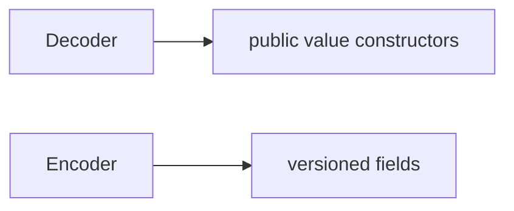

# Conformances

## Purpose and Scope

Explicit host-only Codable implementations. Parent: [LogicDesignSerialization](../DESIGN.md). No children.

## Responsibilities and Boundaries

Own the responsibility identified in Purpose and Scope. Public assumptions and
guarantees are defined once in Contracts and Invariants below.

## Related Designs

| Design | Relationship | Contract Used | Summary | Cautions |
|---|---|---|---|---|
| [LogicDesignSerialization](../DESIGN.md) | parent | composition and ownership | containing design | preserve dependency direction |

## Architecture

## Contracts and Invariants

Own wire coding only. Preserve required fields and route validated values through their checked constructors. Do not reconstruct missing pin bindings or invent semantics.

## Verification and Change Impact

[ContractTests](../../../Tests/LogicDesignTests/ContractTests.swift) and serialization regressions verify exact fields, invalid bit storage and round trips.
