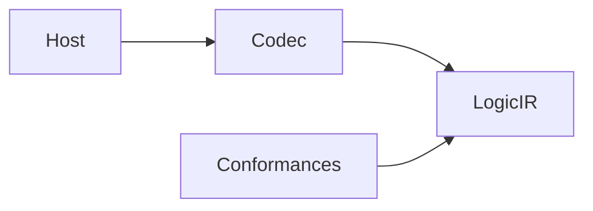

# LogicDesignSerialization

## Purpose and Scope

Host serialization of portable logical values. Parent: [LogicDesign](../../DESIGN.md). Children: [Codec](Codec/DESIGN.md), [Conformances](Conformances/DESIGN.md).

## Responsibilities and Boundaries

Own the responsibility identified in Purpose and Scope. Public assumptions and
guarantees are defined once in Contracts and Invariants below.

## Related Designs

| Design | Relationship | Contract Used | Summary | Cautions |
|---|---|---|---|---|
| [LogicDesign](../../DESIGN.md) | parent | composition and ownership | containing design | preserve dependency direction |

## Architecture

## Contracts and Invariants

Own JSON/Codable integration, digest computation and structural netlist I/O. Core values and validators remain in LogicIR. Importing LogicIR does not import this module. Source bytes and semantic identities are verified at the host boundary.

## Verification and Change Impact

[LogicDesignTests](../../Tests/LogicDesignTests) own round trips and malformed-input rejection. Changes affect host consumers that persist or decode LogicIR values; pure kernels do not depend on this target.
