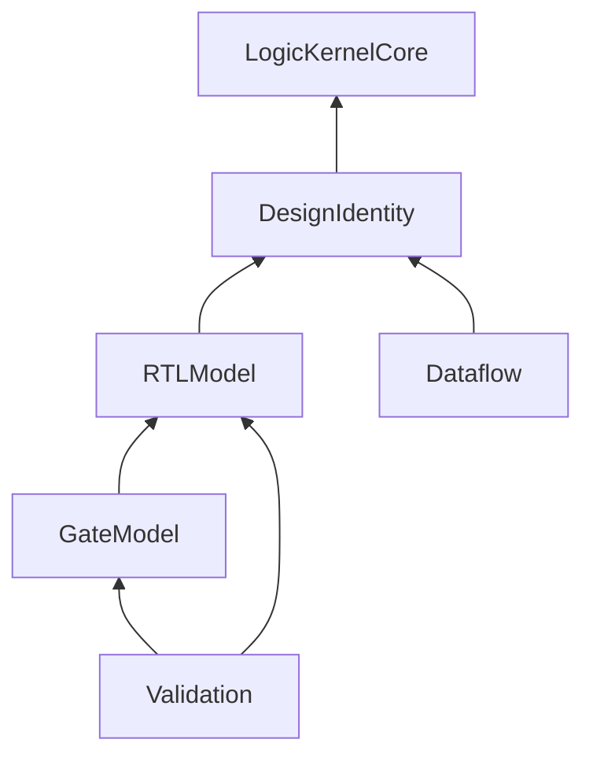

# LogicIR

## Purpose and Scope

Portable logical values and validated circuit representations. Parent: [LogicDesign](../../DESIGN.md). Children: [ResolvedRTL](ResolvedRTL/DESIGN.md), [SourceModel](SourceModel/DESIGN.md), [WordGraph](WordGraph/DESIGN.md), [GraphConnectivity](GraphConnectivity/DESIGN.md), [BitGraph](BitGraph/DESIGN.md), [LogicValues](LogicValues/DESIGN.md), [RTLModel](RTLModel/DESIGN.md), [GateModel](GateModel/DESIGN.md), [Dataflow](Dataflow/DESIGN.md), [DesignIdentity](DesignIdentity/DESIGN.md), [Validation](Validation/DESIGN.md).

## Responsibilities and Boundaries

[CellFunctions](CellFunctions/DESIGN.md) owns immutable, validated dense Boolean
functions for technology cells. Pin/state binding and execution remain consumer
contracts; a valid function value alone is not a mapped design or proof.

Own the responsibility identified in Purpose and Scope. Public assumptions and
guarantees are defined once in Contracts and Invariants below.

## Related Designs

| Design | Relationship | Contract Used | Summary | Cautions |
|---|---|---|---|---|
| [LogicDesign](../../DESIGN.md) | parent | composition and ownership | containing design | preserve dependency direction |

## Architecture

## Contracts and Invariants

Own circuit meaning and value validation. No Foundation, Codable, filesystem, crypto, JSON or host library dependency. Legacy mutable RTL/Gate values are drafts for parsing; only validated stage-specific owners establish synthesis invariants.

## Verification and Change Impact

[LogicDesignTests](../../Tests/LogicDesignTests) own existing draft validation. Portable graph/bit-vector tests and runtime probes are added alongside validated owners. Host byte contracts are owned by [LogicDesignSerialization](../LogicDesignSerialization/DESIGN.md).
