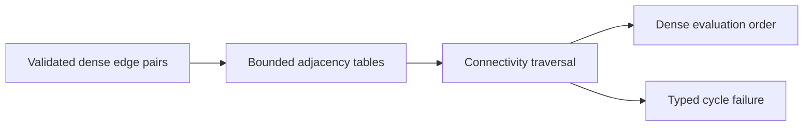

# GraphConnectivity

## Purpose and Scope

Connection-derived topology shared by validated word and bit representations.
Parent: [LogicIR](../DESIGN.md). No children.

## Responsibilities and Boundaries

Own bounded Kahn traversal and CSR adjacency construction. Representation validators
own width, arity, port/state meaning and reference admission. Never order by names.

## Related Designs

| Design | Relationship | Contract Used | Summary | Cautions |
|---|---|---|---|---|
| [LogicIR](../DESIGN.md) | parent | portable values | common topology | no host dependencies |
| [BitGraph](../BitGraph/DESIGN.md) | used by | admitted bit connections | includes transparent latch dependencies | FF outputs break paths |
| [WordGraph](../WordGraph/DESIGN.md) | used by | admitted word connections | explicit state controls | validate indices first |
| [ExecutionControl](../../LogicKernelCore/ExecutionControl/DESIGN.md) | depends on | reservations/work | cumulative bounds | same invocation context |

## Architecture

## Contracts and Invariants

Inputs are in-range edge pairs and a nonnegative node count. Return every node
exactly once after its dependencies, or fail for cycles/resource/cancellation.
Parallel duplicate edges count independently and decrement independently. Generic
index construction is static at specialization. Output storage belongs to the
caller reservation; temporary CSR arrays have a local reservation.

## State, Ownership, and Lifecycle

All arrays are invocation-local. Release temporary storage on success and failure.
No callbacks, shared mutable state, target-specific storage or escaping views.

## Verification and Change Impact

BitGraphTests and WordGraphTests own forward-edge, cycle and failure behavior.
Changing topology requires rechecking both representation validators and the
portable runtime probes. No semantic equivalence claim follows from topology.
