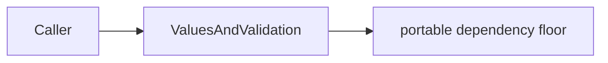

# RTLModel

## Purpose and Scope

RTL parse values, parameter/generate and hierarchy elaboration. Parent: [LogicIR](../DESIGN.md). No children.

## Responsibilities and Boundaries

Own the responsibility identified in Purpose and Scope. Public assumptions and
guarantees are defined once in Contracts and Invariants below.

## Related Designs

| Design | Relationship | Contract Used | Summary | Cautions |
|---|---|---|---|---|
| [LogicIR](../DESIGN.md) | parent | composition and ownership | containing design | preserve dependency direction |

## Architecture

## Contracts and Invariants

RTL parse values, parameter/generate and hierarchy elaboration. Legacy string identity generation is injected through `LogicDraftIdentityGenerating`; host hashing and coding remain outside this component. Public draft values do not assert stage-specific synthesis validity.

## Verification and Change Impact

[LogicDesignTests](../../../Tests/LogicDesignTests) own behavioral checks for this component. Changing value meaning requires host serialization and consuming kernel regression checks.
