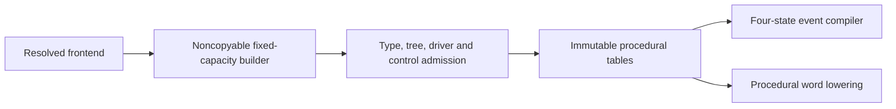

# ResolvedRTL

## Purpose and Scope

Own immutable typed, flattened procedural RTL after names, hierarchy, parameters,
static expansion, widths and signedness have been resolved. Parent:
[LogicIR](../DESIGN.md). No children. This is a procedural program, not a word
circuit with a different stage marker.

## Responsibilities and Boundaries

Own dense signal/expression/statement references, ordered assignment timing,
case priority, explicit process events, initial values and exact origins.
Frontend owns source interpretation and synthesis-profile admission. Word lowering
owns conversion of procedural environments/NBA queues into selections, next-state
and latch controls. Simulation owns four-state event execution.

## Related Designs

| Design | Relationship | Contract Used | Summary | Cautions |
|---|---|---|---|---|
| [LogicIR](../DESIGN.md) | parent | immutable stage publication | typed procedural IR | not a circuit evaluator |
| [WordGraph](../WordGraph/DESIGN.md) | depends on | value types and opcode typing | resolved expression sizes | no implicit extension |
| [GraphConnectivity](../GraphConnectivity/DESIGN.md) | depends on | expression topology | dense dependencies | names never order execution |
| [SourceModel](../SourceModel/DESIGN.md) | coordinates with | exact source origins | diagnostic binding | host verifies content digest |

## Architecture

## Contracts and Invariants

The canonical topModuleID identifies the selected flattened module. Signals are
primary inputs or persistent procedural variables. Initial vectors
have exact width; unspecified variables initialize to X in simulation and admit
all binary initial states when they become synthesis state. This model can retain
four-state constants for simulation; the initial synthesis frontend/lowering
profile separately rejects X/Z dependencies.

Expressions use WordLogicType and explicitly sized WordLogicOpcode operations;
case equality is separate and yields a known unsigned one-bit value. Dynamic
selection takes a vector and a signed/unsigned normalized bit offset, producing
an unsigned packed selection. Each out-of-range selected bit is X; an unknown
offset yields X. The frontend resolves declared packed index direction/base
into that mathematical offset without arithmetic overflow. Initial synthesis
must prove the observed selection is binary or reject its X dependency. Signal reads
have the signal's exact type. Expression dependencies are acyclic and topology
comes from connectivity. Statements preserve source order, blocking/NBA timing,
partial assignment ranges, first-matching ordinary case and optional default.
An assignmentGroup samples every RHS and conditional address guard from the same
pre-write environment, then applies selected writes in child/source order. Its
subtrees contain only assignments, conditionals, nested assignment groups and
empty leaves; ordinary sequential blocks/cases are rejected. This preserves one
packed concatenation/dynamic lvalue assignment without exposing auxiliary state.
NBA values/addresses are likewise sampled before queueing. A continuous process
may own one blocking assignment or one entirely blocking assignment group.
Statement child/body references point to earlier entries, preventing recursive
program cycles without a recursion-depth assumption. Flat child, case-item and
case-match ranges are contiguous and owned exactly once.

Process controls distinguish continuous assignment, always_comb, explicit FF
clock/edge/asynchronous-reset role, explicit latch declaration, and general
level-sensitive execution. Event-list spelling order never chooses a clock.
Clock/reset expressions must be unsigned one-bit. Explicit FF declarations share
one clock/edge; explicit FF/latch mixtures are outside the initial profile.
An inferred latch and its single gate/polarity are established by word lowering,
not guessed from a procedural declaration. Combinational completeness and
transparent circuit cycles are likewise checked during procedural conversion.

Profile conflicts (clock/edge and explicit FF/latch mixing) and overlapping
process drivers and invalid assignment targets report the offending process/statement origin when available,
using language-neutral LOGIC_RTL source failure codes. Origin-free hand-built IR
retains its existing unsupported/invalidModel errors. This common validator owns
the decision; frontend composition does not duplicate profile/driver analysis.

No input bit is assigned. Each variable bit has at most one process writer;
repeated writes within that process retain their declared ordering. Input port
bindings are unique and complete. Output ports observe retained signal values.
Undriven procedural variables remain explicit X/initial storage, never zero.
Initial synthesis admission must reject reachable unsupported storage before
publishing a word circuit. Builder publication establishes these RTL invariants,
not functional equivalence or successful synthesis admission.

## Runtime Flows

| Control | Scheduling meaning retained for the simulation compiler |
|---|---|
| continuous | initial RHS evaluation and subsequent RHS dependency changes; one blocking assignment |
| combinational | always_comb initial execution and implicit sensitivity excluding written variables |
| flipFlop | declared clock edge or asynchronous reset assertion edge; original ordered body executes |
| latch | always_latch scheduling; body retains original guard and hold behavior |
| levelSensitive | always @* full resolved read-dependency sensitivity; no invented initial execution |

Explicit incomplete source sensitivity lists must not be normalized to full
sensitivity; the initial frontend rejects them if their meaning cannot be retained.
Clock/reset descriptors identify triggering roles and never replace procedural
reset branches. Statement conditions treat X/Z as not true; expression select
retains four-state conditional merge. Case items retain first-match priority.
Cross-process scheduling races must be rejected by the compiling frontend/model
boundary rather than resolved by an arbitrary process traversal order.

## State, Ownership, and Lifecycle

Builder owns fixed-capacity contiguous tables and transfers them through consuming
finish. Final storage is immutable Sendable. Borrow APIs retain concrete local
owners through their Span callbacks, with Span() for empty tables. Process/runtime
mutable values are never stored in the design.

## Failure, Concurrency, and Constraints

Table capacities, variable bit totals, operand/statement edges, names, validation
scratch and expression topology are admitted through one cumulative context.
Checked size arithmetic precedes allocation. Validation traversal is iterative;
per-process visited flags bound structural driver checking even when statement
subtrees are shared. No target weakens Sendable or introduces shared mutable state.

## Verification and Change Impact

ResolvedRTLTests reject invalid types/references/ranges, expression cycles,
recursive statements, cross-process overlapping bit drivers, input writes,
invalid initial widths and ambiguous explicit controls. Positive tests preserve
ordered blocking/NBA, partial writes, case priority, forward expressions, origins
and unspecified initial state. Portable probes cover construction and table
borrowing. Frontend and word-lowering tests own source interpretation and actual
procedural behavior; those guarantees cannot be inferred from structural tests.
