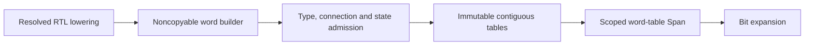

# WordGraph

## Purpose and Scope

Typed, resolved two-state word operations and explicit state updates. Parent:
[LogicIR](../DESIGN.md). No children. Procedural RTL and bit expansion have separate
owners; this representation never interprets string operators or technology cells.

## Responsibilities and Boundaries

Own word widths/signedness, dense value references, operand tables, port binding,
state controls, origins and validated immutable publication. Lowering must insert
explicit extension, truncation/slicing, bitcasts and truth conversions before
publication. No implicit sizing or scheduling remains in the graph.

## Related Designs

| Design | Relationship | Contract Used | Summary | Cautions |
|---|---|---|---|---|
| [LogicIR](../DESIGN.md) | parent | immutable portable values | word representation | no serialization dependencies |
| [LogicValues](../LogicValues/DESIGN.md) | depends on | width and packed values | exact constants | constants must be two-state |
| [GraphConnectivity](../GraphConnectivity/DESIGN.md) | depends on | validated dense topology | evaluation order | validate all references before traversal |
| [ResolvedRTL](../ResolvedRTL/DESIGN.md) | used by | internal WordOperationValidation.validate and value types | one operation typing authority | scheduling stays procedural |
| [BitGraph](../BitGraph/DESIGN.md) | depends on | port direction, edge/reset enums and bit state profile | shared control meaning and lowering destination | preserve each state bit |

## Architecture

## Contracts and Invariants

Each node produces one positive-width typed value. Opcode determines arity.
Arithmetic/bitwise operands have the declared result type; arithmetic is modulo
2^width. Equality/ordering compare equal types and produce unsigned one-bit values.
Ordering uses the operand type's signedness. Logical/reduction operations produce
unsigned one-bit values. Shifts retain the left type; the right operand is unsigned
and independently sized. Arithmetic right shift uses sign fill only for a signed
left value. Select requires a one-bit unsigned condition and identical branch and
result types. Concatenation is unsigned, with the first operand most significant.
Slice is an unsigned in-range consecutive selection. Bitcast preserves width;
zero/sign extension never narrows and sign extension requires a signed source.
Constants have exact width and no X/Z bits. Internal operation type admission is
shared with [ResolvedRTL](../ResolvedRTL/DESIGN.md), whose procedural expressions
retain the same explicit sizing rules; procedural scheduling is not shared.

Node/port/state identities are unique within their tables. Input bindings cover
every input exactly once; output bindings can observe any value. Every state has
one matching state-output node and equal next-state type. Initial state is an
explicit binary vector or unrestricted, never implicit zero. Clock/gate/enable/
reset values are unsigned one-bit. Reset dominates enable/data. State profiles
and transparent-cycle rules follow the shared meaning defined by
[BitGraph](../BitGraph/DESIGN.md), using word indices rather than bit indices.

## State, Ownership, and Lifecycle

Builders own fixed-capacity mutable arrays and publish through consuming finish.
Design storage is a final immutable Sendable owner. Concrete local array retention
covers every Span callback; no view escapes or crosses await. Empty tables use an
empty Span on all targets. Borrow APIs require macOS 26 on Darwin.

## Failure, Concurrency, and Constraints

Caller capacities and the same invocation context bound tables, expansion, managed
storage and work. Arithmetic capacity overflow fails before allocation. Generated
constants have their own prior value reservation. Published table capacities remain
conservatively charged for the invocation. Validators and topology release their
temporary reservations on every exit. No target changes state isolation or Sendable.

## Verification and Change Impact

WordGraphTests reject incorrect widths/signs/arity/extensions/slices/conditions,
X/Z constants, invalid bindings/references, mixed controls and transparent cycles.
Portable probes execute actual publication and borrowing. Word-to-bit differential
tests own operation meaning; source sizing and procedural meaning remain owned by
frontend/RTL lowering tests. Changes require rechecking those consumers.
