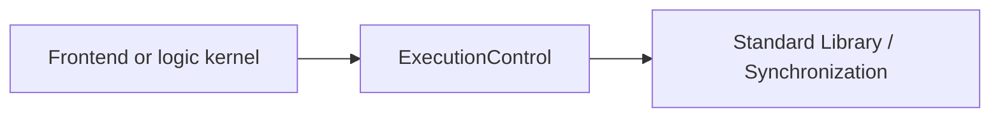

# LogicKernelCore

## Purpose and Scope

Portable execution contracts shared by frontend and logic kernels. Parent:
[LogicDesign](../../DESIGN.md). Child:
[ExecutionControl](ExecutionControl/DESIGN.md).

## Responsibilities and Boundaries

Own typed kernel errors, resource limits, cumulative budget accounting and
synchronous cancellation/deadline observation. Own no circuit schema, parsing,
artifact I/O, clock backend, policy, or tool qualification.

## Related Designs

| Design | Relationship | Contract Used | Summary | Cautions |
|---|---|---|---|---|
| [LogicDesign](../../DESIGN.md) | parent | target dependency graph | frontend composition | no dependency on LogicEngine |
| [ExecutionControl](ExecutionControl/DESIGN.md) | child | context and control | bounded pure work | one context per run |
| [CircuiteFoundation](../../../CircuiteFoundation/DESIGN.md) | depends on | portable identity contracts | dependency floor | no host products |
| [LogicEngine](../../../LogicEngine/DESIGN.md) | used by | cumulative kernel context | calculation stages | do not reset budgets |

## Architecture

## Contracts and Invariants

Public values are Sendable and validated. Context is noncopyable and invocation
local. Every stage consumes the same budget. Shared cancellation uses the same
Mutex storage and requirement on Native, WASM and Embedded.

## Verification and Change Impact

[Kernel tests](../../Tests/LogicKernelCoreTests) own bounds, failure atomicity and
shared cancellation. The portable probe executes the same implementation on all
three targets. Changes affect frontend and every LogicEngine kernel.

The additive external accountant and explicit success/failure retention scopes are
owned by [ExecutionControl](ExecutionControl/DESIGN.md#proposed-shared-accounting-and-controlled-retention).
The legacy initializer remains local-only. Host causes remain outside the portable
Equatable kernel error; host codec failure owners retain their exact payloads.
