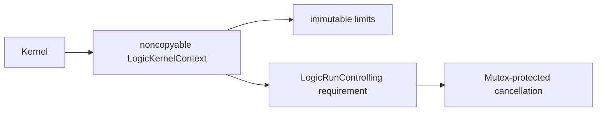

# ExecutionControl

## Purpose and Scope

Implement the shared bounded execution contract. Parent:
[LogicKernelCore](../DESIGN.md). No child components.

## Responsibilities and Boundaries

Own validated finite limits, cumulative work/output counters, retained/peak
managed-storage reservations, checkpoint observation and shared cancellation.
Source diagnostics bind byte ranges to exact CircuiteFoundation artifact identities.
The caller supplies a real deadline control; this component owns no wall clock,
filesystem, task lifecycle, or process RSS guarantee.

## Related Designs

| Design | Relationship | Contract Used | Summary | Cautions |
|---|---|---|---|---|
| [LogicKernelCore](../DESIGN.md) | parent | portable execution boundary | common context | preserve one run owner |

## Architecture



## Contracts and Invariants

Limits are explicit and positive. Arithmetic overflow is rejected before mutation.
A rejected charge leaves counters unchanged. Storage reservations are released
exactly once through opaque context-owned receipts; cross-context and duplicate
releases fail. Peak storage includes concurrent old/new buffers. Total allocations, reservation count
and work remain cumulative, including zero-byte receipts. Receipt registry cardinality
is separately bounded; caller-requested storage bytes exclude allocator/registry overhead. Cancellation and deadline errors remain distinct.

## State, Ownership, and Lifecycle

Each run owns one noncopyable context. Receipts are noncopyable and bound to that
context's identity. The cancellation source is Sendable and protects its Boolean
state with Mutex on every target. No callbacks run under its lock. Deadline
observation is supplied by the platform through LogicRunControlling.

## Failure, Concurrency, and Constraints

Failures remain typed LogicKernelError values for invalid input/model, source,
unsupported semantics, resource limits, cancellation, deadline and the additive
external-accounting marker. Accounting limits cover managed algorithm storage, not
allocator metadata or total process RSS. Concurrent access to a context is not
exposed. Control may be called by multiple runs and must be Sendable.

## Verification and Change Impact

[LogicKernelCoreTests](../../../Tests/LogicKernelCoreTests) verify overflow, exact
limits, unchanged counters after failure, reservation ownership and cancellation.
Native tests exercise concurrent cancellation. Portable probes exercise the same
Mutex, context and protocol requirement under Native and both matching WASM SDKs.
Budget semantic changes require frontend and logic-kernel regression checks.

The ordinary portability executable and Embedded executable share
LogicKernelProbeSupport. Only the Embedded executable links the SDK's Unicode
normalization tables required by CircuiteFoundation; no synchronization or Sendable
contract differs between these targets. macOS cancellation uses the standard
Mutex and therefore requires macOS 15, while the package's other values preserve
the existing macOS 14 deployment contract.

| Target | Storage | Isolation | Read / mutation | Owner release |
|---|---|---|---|---|
| Native | Mutex<Bool> | standard Mutex | isCancelled/checkpoint; cancel | last strong reference |
| WASM | Mutex<Bool> | SDK Mutex backend | same source requirements | last strong reference |
| Embedded WASM | Mutex<Bool> | SDK Mutex backend | same source requirements | last strong reference |

The Native concurrent test and both WASI sequential probes have different evidence
scopes. WASI execution does not establish multi-threaded blocking semantics.

## Shared Accounting and Controlled Retention

The additive boundary is verified by focused Native tests and the same fixed
Swift 6.4.0 Native, ordinary WASM and Embedded WASM probes. These scoped results
do not qualify a composed host reload or parallel WASI execution. Existing
initializers, local limits, typed errors and invocation-conservative storage
semantics remain.

A new optional class-bound `LogicKernelAccounting: AnyObject, Sendable` requirement forwards bit-width observations,
cumulative resource charges, and storage admissions to one caller-owned accountant.
The existing initializer has no accountant; an additive initializer accepts one.
Every operation completes all local overflow/limit/identity checks before invoking
the accountant, and commits local counters only after that invocation succeeds.
The storage callback atomically admits live bytes, cumulative allocation bytes and
one reservation before returning a `LogicKernelStorageRetaining` lease. It must
not partially commit if it refuses. No guessed limit-sized admission or subsequent
usage transfer substitutes for actual admissions.

The portable callback throws only `LogicKernelError`. The distinct
`externalAccountingFailure` case preserves that enum's Sendable/Equatable contract;
the host adapter retains and rethrows its original cause at the host boundary. The
kernel never stores `any Error`. Callback implementations may retain a host failure
owner, and no callback runs under a kernel synchronization lock.

An explicit noncopyable retention scope records the first reservation identity.
Successful controlled publication transfers its still-live external storage leases
to an immutable, copyable `LogicKernelRetention` anchor. Failure discards only
storage reservations made within that scope; cumulative work, allocation and
reservation-count charges remain. Temporary receipts are released before success.
Scopes require exact context identity and one active scope; misuse is typed failure.
The local invocation-conservative usage remains charged on successful transfer;
external live storage follows the returned anchor's last copy. Both error cleanup
and last-owner release are noncancellable. This scope is not a resource reset.

```text
local checks -> caller atomic admission -> local commit -> actual allocation
                                   storage lease
                                       |
                         scope failure | successful publication
                         release bytes | immutable result retention
                                       | last copy: noncancellable refund
```

The same protocol requirements and immutable lease ownership apply to Native,
WASM and Embedded. Shared mutable host adapter state must use the same Mutex or
actor contract on all targets. No Foundation dependency enters this component.

Required focused evidence includes refusal at each admission before local commit,
unchanged legacy usage, exact callback order, overflow before callback, foreign
scope refusal, partial construction cleanup, noncancellable release and retained
result copies. Host tests preserve the actual underlying external cause.

The installed accounting object has reference identity.
`requireAccounting(expected:)` rejects a different object even if its counters and
limits are equal. Runtime installs and passes the same adapter; it does not wrap or
substitute it during reload. This requirement is identical on every target.

External callbacks are followed by the actual run-control checkpoint before local
commit or caller-owned growth. If a callback admits and then cancellation is observed,
local counters remain unchanged and a temporary storage lease is destroyed without
checking cancellation. Already admitted external work/allocation remain cumulative;
this is distinct from atomic admission refusal, which commits nothing externally.

### Already-accounted source phases

`importAccountedPhase(peakStorageBytes:allocationBytes:storageReservations:workUnits:expectedAccounting:)`
is a trusted-adapter seam for a phase whose exact same installed accountant has
already admitted every action. The caller exclusively owns the parent context,
supplies its four remaining ceilings before the phase, and imports the phase's
actual counters exactly once on success or failure. Allocation must cover the
phase peak and nonzero storage requires at least one reservation. All owner,
overflow and local-limit checks precede a single local commit; no external callback,
new lease, cancellation checkpoint or work refund occurs during import. Local
storage conservatively retains the phase peak as the legacy Liberty composition
did. Actual external storage leases remain with the lower source owner. This
method cannot substitute for pre-action external accounting.

`checkpointControl` returns the existing Sendable run-control value for a
synchronous/async host adapter to retain. It exposes neither mutable counters nor
a borrowed context pointer, creates no new deadline, and lets adapters observe
the original control while also checking their caller's external control.

### Failure transfer without late admission

beginRetentionScope preadmits the immutable anchor's logical fields before the
controlled operation begins. Successful finish observes the original run control
and transfers the dictionary without another admission. `retainFailureScope` only
validates the exact active scope and transfers already admitted leases; it never
calls an accountant, observes cancellation or resets cumulative charges. This
allows a host failure owner to keep source-derived diagnostics alive even when
no budget remains. Its own wrapper fields must have been admitted by the host
before source work. An inactive/foreign token is always rejected. Both transfer
paths consume the active scope logically, though the noncopyable token is borrowed
so a failed success checkpoint can still enter failure cleanup.

| State | Native | WASM | Embedded | Access and release |
|---|---|---|---|---|
| Context counters/scoped dictionary | noncopyable invocation-local | same | same | exclusive mutating context methods; no shared access |
| Published retention | immutable class/dictionary/leases | same | same | Sendable readonly sharing; last ARC owner releases leases |
| Cancellation | Mutex<Bool> | same | same | original checkpoint/cancel requirements |
| Probe accountant | Mutex<State> | same | same | requirement callbacks update state; lease deinit refunds outside caller locks |

No `hasFeature(Embedded)` or synchronization-availability branch is added. The
existing shared portability probe now executes actual external admission,
rollback, transfer, copy lifetime and typed refusal through these same requirements.
Native, ordinary WASM and Embedded evidence must each be recorded; no portability
result is inferred from compilation of a different target.

### Controlled registry backing ownership

Controlled reservations admit their requested payload separately from each concrete
registry backing. The invocation owns the `reservations`, `externalReservations`
and `scopedReservations` dictionaries exclusively. A backing lease covers the whole
nonempty table, including spare key/value buckets, occupancy words and declared
storage-header fields. The layout profile follows the pinned Swift 6.4.0
[DictionaryStorage](https://github.com/swiftlang/swift/blob/swift-6.4.0-RELEASE/stdlib/public/core/DictionaryStorage.swift)
and [HashTable](https://github.com/swiftlang/swift/blob/swift-6.4.0-RELEASE/stdlib/public/core/HashTable.swift)
implementation: power-of-two bucket count, three-quarter maximum load, separate
aligned key/value tails and ceiling-divided occupancy words. Target `MemoryLayout`
values determine strides and alignment; allocator size classes/private workspace
remain excluded. This is a logical payload contract, not process RSS.

Before growth, checked arithmetic and all local payload/work ceilings precede
external admissions. New backing leases coexist with the old backing leases;
copying/initialization work is charged through the same external accountant before
allocation or copying. The actual run control is checked after each callback and
during copies. Only a successful reservation commits local administrative work
and payload counters. Refusal or cancellation destroys pending tables before their
leases and preserves the old dictionaries and local usage. External actions that
already succeeded remain cumulative if a later action refuses; individual callback
refusal is still atomic. The path without an accountant keeps its original counters
and allocation behavior.

Removing the final entry replaces a dictionary with the empty singleton before
releasing its backing lease. Nonempty tables retain their complete capacity lease.
Scope publication moves the scoped dictionary and its backing lease together into
`LogicKernelRetention`; failure discard clears the dictionary before refunding it.
Anchor metadata includes its concrete dictionary/lease fields and is admitted at
scope begin. Published storage is immutable and retains macOS 14 availability.
Dictionary fields precede their backing leases in the pinned Swift 6.4.0 destruction
order, both in the context and the published anchor. Actual typed lease events in
Native, WASM and Embedded probes must verify entry teardown before backing refund;
field order alone is not qualification evidence. Explicit mutable release paths
clear dictionaries first. No cancellation or synchronization lock participates in
last-owner refund.

Copy-failure cleanup clears both temporary dictionaries before extending the
lifetime of the concrete `LogicKernelExternalReservation` entry that owns the
payload lease. This retains the same lease without opening its existential as a
generic argument, which the pinned Embedded compiler cannot specialize. The
optional backing-lease owners remain retained through the same cleanup boundary.
All targets use this identical ownership path without a cast or target branch.

```text
old table + old lease -> admit new table + payload + work -> copy -> commit
                                                        -> failure: drop new
final entry removal -> empty singleton -> backing refund
scope transfer -> dictionary + backing lease -> last anchor copy -> refund
```

Legacy local payload usage remains invocation-conservative and excludes registry
metadata. Controlled external live bytes include actual registry backing. Local
administrative work is cumulative after successful controlled reservations. These
metrics must not be conflated. Focused evidence covers zero-byte receipts, old/new
growth peaks, refusal and cancellation before mutation, partial scope rollback,
empty-table release and copied-anchor lifetime on Native and both WASM modes.
