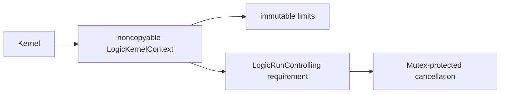

# ExecutionControl

## Purpose and Scope

Implement the shared bounded execution contract. Parent:
[LogicKernelCore](../DESIGN.md). No child components.

## Responsibilities and Boundaries

Own validated finite limits, cumulative work/output counters, retained/peak
managed-storage reservations, checkpoint observation and shared cancellation.
Source diagnostics bind byte ranges to exact CircuiteFoundation artifact identities.
The caller supplies a real deadline control; this component owns no wall clock,
filesystem, task lifecycle, or process RSS guarantee.

## Related Designs

| Design | Relationship | Contract Used | Summary | Cautions |
|---|---|---|---|---|
| [LogicKernelCore](../DESIGN.md) | parent | portable execution boundary | common context | preserve one run owner |

## Architecture

## Contracts and Invariants

Limits are explicit and positive. Arithmetic overflow is rejected before mutation.
A rejected charge leaves counters unchanged. Storage reservations are released
exactly once through opaque context-owned receipts; cross-context and duplicate
releases fail. Peak storage includes concurrent old/new buffers. Total allocations, reservation count
and work remain cumulative, including zero-byte receipts. Receipt registry cardinality
is separately bounded; caller-requested storage bytes exclude allocator/registry overhead. Cancellation and deadline errors remain distinct.

## State, Ownership, and Lifecycle

Each run owns one noncopyable context. Receipts are noncopyable and bound to that
context's identity. The cancellation source is Sendable and protects its Boolean
state with Mutex on every target. No callbacks run under its lock. Deadline
observation is supplied by the platform through LogicRunControlling.

## Failure, Concurrency, and Constraints

Only invalid input, unsupported semantics, resource limit, cancelled and deadline
failures are thrown. Accounting limits cover managed algorithm storage, not
allocator metadata or total process RSS. Concurrent access to a context is not
exposed. Control may be called by multiple runs and must be Sendable.

## Verification and Change Impact

[LogicKernelCoreTests](../../../Tests/LogicKernelCoreTests) verify overflow, exact
limits, unchanged counters after failure, reservation ownership and cancellation.
Native tests exercise concurrent cancellation. Portable probes exercise the same
Mutex, context and protocol requirement under Native and both matching WASM SDKs.
Budget semantic changes require frontend and logic-kernel regression checks.

The ordinary portability executable and Embedded executable share
LogicKernelProbeSupport. Only the Embedded executable links the SDK's Unicode
normalization tables required by CircuiteFoundation; no synchronization or Sendable
contract differs between these targets. macOS cancellation uses the standard
Mutex and therefore requires macOS 15, while the package's other values preserve
the existing macOS 14 deployment contract.

| Target | Storage | Isolation | Read / mutation | Owner release |
|---|---|---|---|---|
| Native | Mutex<Bool> | standard Mutex | isCancelled/checkpoint; cancel | last strong reference |
| WASM | Mutex<Bool> | SDK Mutex backend | same source requirements | last strong reference |
| Embedded WASM | Mutex<Bool> | SDK Mutex backend | same source requirements | last strong reference |

The Native concurrent test and both WASI sequential probes have different evidence
scopes. WASI execution does not establish multi-threaded blocking semantics.
