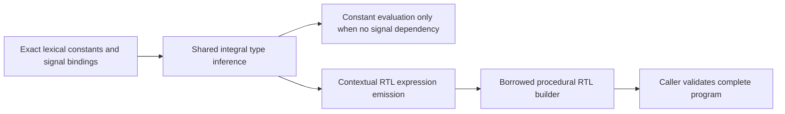

# ExpressionResolution

## Purpose and Scope

Resolve signal/constant names and compile typed SystemVerilog expressions into
explicitly sized procedural RTL expressions. Parent: [Frontend](../DESIGN.md).
No children. Hierarchy, signal creation, procedural execution and final publication
are frontend composition responsibilities.

## Responsibilities and Boundaries

Own immutable signal bindings tied to exact lexical owners and the translation
from one shared integral type inference to explicit RTL operations. ConstantEvaluation
remains the authority for integral type inference, literal decoding, packed dimensions
and constant evaluation. It accepts runtime type facts for inference only; attempting
to evaluate a runtime-dependent expression as a constant fails at its source.
The caller owns the builder and canonical entity-ID namespace; the compiler borrows
them synchronously and commits generated IDs through a checked run-local counter.

## Related Designs

| Design | Relationship | Contract Used | Summary | Cautions |
|---|---|---|---|---|
| [Frontend](../DESIGN.md) | parent | composition | resolved expressions | not source acceptance |
| [Constants](../ConstantEvaluation/DESIGN.md) | depends on | shared integral inference and evaluation | width/sign authority | runtime facts cannot become dummy constants |
| [StaticScopes](../StaticScopes/DESIGN.md) | depends on | exact lexical owners and frozen constants | nearest names | parent identity must match |
| [ResolvedRTL](../../LogicIR/ResolvedRTL/DESIGN.md) | depends on | explicit typed expression builder | output | builder capacities and final validation belong to caller |
| [ExecutionControl](../../LogicKernelCore/ExecutionControl/DESIGN.md) | depends on | cumulative budgets | bounded scratch | all temporary metadata admitted |

## Architecture

## Contracts and Invariants

Bindings use declaration and dense signal identity, preserving packed dimensions.
Each direct runtime variable/net/port name has exactly one binding; non-ANSI
header/body declarations denote the same binding. Constants, genvars, scope labels
and instances cannot be substituted by runtime signals. Parent chains follow the
same exact lexical owners as constant scopes. Nearest declarations block outer names.
The supplied signal type must equal its resolved declaration type; the enclosing
composition must also bind it to a matching actual builder signal and direction. Multiple names may refer to one connected
signal; composition owns the legality of that connection and driver admission.

Type inference is shared with constants. Context width/sign propagates before
arithmetic; assignment retains RHS signedness, comparison uses common operand
context, shifts retain self-determined counts, casts and concatenations retain
self-determined operands. Emitted operands have explicit extension, bitcast and
truncation; each operation satisfies the ResolvedRTL type validator. Concatenation
preserves source order and zero repetitions are allowed only inside a nonempty
concatenation. Every generated expression retains the relevant source range.

Static selection uses declared packed direction/base and unit width. Dynamic
bit/indexed selection produces a signed mathematical bit offset with sufficient
width for original index, bounds and multiplication; no target Int truncation or
wraparound changes an out-of-range access into an in-range one. Range bounds and
indexed widths are compile-time constants. Static out-of-range selections are refused by the initial synthesis profile.
Dynamic out-of-range/X semantics remain the
ResolvedRTL contract; synthesis lowering separately proves binary range admission.

## State, Ownership, and Lifecycle

Binding storage is immutable Sendable and retains its lexical owner. Metadata,
postorder type/value frames and emission stacks belong to noncopyable run-local
owners. Builders and ID counters are inout; no callback, await, I/O or shared mutation
is introduced. Source borrows never escape. Failed emission cannot publish a design;
the caller discards its incomplete builder. There is no silent alternate evaluator.

## Failure, Concurrency, and Constraints

Type/value/emission tables admit actual-target capacities before allocation.
Checked arithmetic precedes width, stack, operand and ID growth. One cumulative
context owns all work, storage, cancellation and deadline checks. Invalid binding
identity is invalidInput; unsupported source or unresolved names retain source
artifact/range; resource/control failures propagate without becoming values.
Published metadata/value payload remains conservatively charged, temporary scratch
releases on every exit. No allocation/copy or performance improvement is claimed.

## Verification and Change Impact

[ExpressionResolutionTests](../../../Tests/LogicDesignTests/ExpressionResolutionTests.swift) compares independent expected arithmetic over small
input domains and inspect actual explicitly typed builder output. Cover contextual
carry/sign, common unsigned comparisons, casts, shifts, concatenation/repetition,
ascending/descending/multidimensional selection, dynamic negative/large indices,
nearest runtime/constant shadowing, foreign owners, invalid types, limits and cancel.
Native and matching ordinary/Embedded WASM probes execute emitted expressions.
ProbeRTLExpressionEvaluator is verification-only; its binary dispatch consumes
emitted RTL and never reinterprets source expression kinds.
Changes require regression checks of constant/scoped evaluation and complete RTL
validation. These tests do not prove hierarchy, process, simulation or synthesis.
