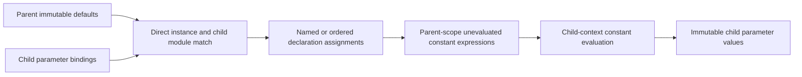

# InstanceParameters

## Purpose and Scope

Resolve named or ordered parameter assignments for a direct module-scope instance
against a supplied child module binding owner. Parent: [SystemVerilogFrontend](../DESIGN.md).
No children. This is parameter composition, not whole hierarchy elaboration.

## Responsibilities and Boundaries

Own exact child module/name matching, instance assignment order, named/ordered
admission and override-to-declaration matching. ConstantEvaluation owns expression
width/sign/value semantics and child-context conversion. Module-library selection,
selected generate scopes, port connectivity and process elaboration remain later
frontend responsibilities. The scoped overload consumes [StaticScopes](../StaticScopes/DESIGN.md) and retains
that owner in each unevaluated override. The module-local overload retains its
existing direct-instance contract.

## Related Designs

| Design | Relationship | Contract Used | Summary | Cautions |
|---|---|---|---|---|
| [Frontend](../DESIGN.md) | parent | stage composition | module-local parameter step | no full frontend acceptance |
| [Binding](../ParameterBinding/DESIGN.md) | depends on | exact declaration identity and overridability | child targets | body parameters may be implicitly local |
| [Constants](../ConstantEvaluation/DESIGN.md) | depends on | retained expressions and contextual overrides | value authority | no pre-evaluation at parent width |
| [Syntax](../SyntaxParsing/DESIGN.md) | depends on | source-retaining module/instance nodes | exact names and ranges | no name normalization by String |

## Architecture

## Contracts and Invariants

The instance must occur directly in the retained parent module, through only
transparent declaration groups/generate regions. Its module name must exactly
match the supplied child module name, including across source documents. Interned
symbol numbers are never compared across owners. Named assignments require an
existing overridable parameter and unique target, even when an empty assignment
retains the default. Ordered assignments skip localparams and implicitly local
body parameters. Mixed named/ordered lists, excess positional entries, missing
names, local targets and duplicates fail at the original parent binding range.
Empty assignments retain defaults. All supplied expressions resolve in the parent
module and are context-evaluated only after child types/ranges are resolved.

## State, Ownership, and Lifecycle

A noncopyable run-local resolver owns bounded traversal, target flags and override
handles. Handles retain immutable parent defaults and exact child bindings; final
child defaults retain their own bindings. Temporary arrays release on every exit.
No shared mutable state or recursive instance traversal is introduced.

## Failure, Concurrency, and Constraints

Actual target strides charge parent traversal capacity, child target flags and
assignment handles before allocation. Each traversal, name byte comparison and
assignment consumes work; the same cumulative context enters constant evaluation.
Typed source failures preserve parent artifact and byte range. Module mismatch and
foreign scope nodes are invalid input; no partial child values are published.

## Verification and Change Impact

[ParameterOverrideTests](../../../Tests/LogicDesignTests/ParameterOverrideTests.swift)
owns direct instance matching, cross-document/escaped names, named ordering,
empty assignments, implicit-local body parameters and invalid lists. Shared probes
execute actual matching and contextual evaluation on Native/WASM/Embedded. Future
hierarchy/port composition must consume this operation without flattening parent
expressions before child type resolution.

The scoped overload requires the instance to belong directly to the supplied
lexical scope. Child module/target matching and contextual conversion are shared
with the module-local path; nested expressions are never flattened at parent width.
