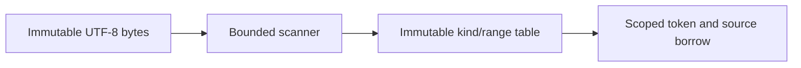

# LexicalAnalysis

## Purpose and Scope

Own bounded byte-range tokenization. Parent: [SystemVerilogFrontend](../DESIGN.md).
No children.

## Responsibilities and Boundaries

Recognize identifiers, escaped identifiers, numbers, strings, punctuation and
operators while retaining original source ranges. Classify keywords in the parser;
classify supported operations in semantic admission. No preprocessor expansion,
number interpretation or filesystem access belongs here.

## Related Designs

| Design | Relationship | Contract Used | Summary | Cautions |
|---|---|---|---|---|
| [SystemVerilogFrontend](../DESIGN.md) | parent | lexical processing | portable frontend | not semantic success |
| [SourceModel](../../LogicIR/SourceModel/DESIGN.md) | depends on | UTF-8 document borrow | retained source | token offsets use bytes |

## Architecture

## Contracts and Invariants

Tokens store kind and half-open byte range; spellings remain in the source owner.
Whitespace and comments are skipped; an explicit EOF is at byteCount. ASCII simple
identifier tokens cover both ordinary names and dollar-prefixed system names;
the parser distinguishes these categories. Ordinary simple names start with a
letter or underscore and may subsequently contain alphanumeric/underscore/dollar.
Escaped identifiers end at whitespace. Non-ASCII UTF-8 is retained in comments,
strings and escaped identifiers. Strings honor backslash escaping; unterminated
strings/comments and unsupported lexical bytes fail with exact source ranges.
Multi-byte operators use longest match. Division/modulo/power can be lexed but
must be rejected by the initial synthesis semantic profile.
Decimal digits and unbased one-bit literals end before a conditional `?`.
Based binary/octal/hex digit sequences retain `?` as a Z digit; based decimal
digits end before it unless it is the single unknown digit. Literal value and
radix validation remain owned by literal decoding, not token scanning.

## State, Ownership, and Lifecycle

Scanner cursor and mutable output are run-local. Tokens are published through an
immutable Sendable owner retaining their source. No token spelling allocation is
needed while scanning. Parser conversion to names occurs only when binding symbols.
The package-internal checked `token(at:)` returns a small token value while the
cursor retains this concrete source owner. It never returns an escaping Span.

## Failure, Concurrency, and Constraints

A caller-supplied maximumTokens includes EOF. The scanner reserves that capacity
before allocation and rejects excess tokens. Per-byte work and emitted expansion
are cumulative; cancellation/deadline checks use the context. No target branch
changes ownership, Sendable or state isolation.

## Verification and Change Impact

Focused source/lexical tests and portable runtime probes exercise actual admission,
byte offsets and resource/cancellation failures. Changes require rechecking the
parser and host source acquisition path. Lexical success establishes no elaboration,
synthesis, simulation or proof guarantee.

Token streams retain SystemVerilogSourceText, whose exact and transformed byte
borrows and original-artifact projection are owned by [SourceText](../SourceText/DESIGN.md).
Token ranges index lexical text; diagnostics project through that contract.
