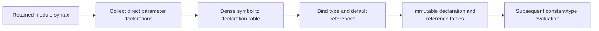

# ParameterBinding

## Purpose and Scope

Bind references in the types and defaults of one module's parameter/localparam
declarations. Parent: [SystemVerilogFrontend](../DESIGN.md). No children.
This package-internal stage publishes a parameter reference table, not values or
an ElaboratedRTL result.

## Responsibilities and Boundaries

Own the module-local constant-name namespace, duplicate admission, declaration
order and identifier-to-declaration edges. Consume the retained syntax owner.
Constant evaluation owns widths, signedness, X/Z admission and computed values.
Hierarchy elaboration owns overrides, selected generate scopes, nested procedural
scopes, all-value namespace conflicts and input/output connections. This component
does not report whole-module semantic acceptance.

## Related Designs

| Design | Relationship | Contract Used | Summary | Cautions |
|---|---|---|---|---|
| [SystemVerilogFrontend](../DESIGN.md) | parent | portable processing | composition | binding is not elaboration |
| [SyntaxParsing](../SyntaxParsing/DESIGN.md) | depends on | immutable nodes, interned symbols and child ranges | source-retaining input | no spelling copies or new string lookup |
| [ExecutionControl](../../LogicKernelCore/ExecutionControl/DESIGN.md) | depends on | cumulative context and reservations | bounded work/storage | use the caller's context |

## Architecture

## Contracts and Invariants

The input must be a parser-published tree and a module node in that tree.
Header parameters precede direct module-body parameters. Group nodes and generate
regions are transparent containers; generate blocks, conditional/loop/case
generate and procedural bodies establish later elaboration work and are not
descended into. Every declaration is retained in original order, including unused
parameters. Same-name parameters in different modules remain independent.

Identifiers in parameter packed dimensions and defaults resolve only to earlier
module-local parameter/localparam declarations. Undefined/nonconstant names,
duplicate parameter names, self reference and declaration-before-use violations
fail with exact source artifact/range. Mutual dependency cycles necessarily fail
declaration-position admission; no recursive parameter chasing is performed.
All expression operands are bound, including unselected conditional branches.
Escaped and ordinary equal names use the parser's exact-byte interned symbol.

The source-order rule is cross-checked against the primary [slang parameter
tests](https://github.com/MikePopoloski/slang/blob/master/tests/unittests/ast/ParameterTests.cpp)
and [lookup implementation](https://github.com/MikePopoloski/slang/blob/master/source/ast/Lookup.cpp).
These are references, not the execution backend.

Declaration tables retain syntax node indices. Reference tables contain the
target declaration node or -1 outside the bound parameter expressions. Checked
lookup and closure-based Span borrows expose no mutable array. An internal owner-identity
comparison binds later override handles to the exact child binding publication. There is no
implicit net creation or zero-valued fallback.

## State, Ownership, and Lifecycle

One noncopyable binder owns mutable dense tables, visit flags and an explicit
work stack. It transfers published arrays into immutable final Sendable storage
retaining the syntax owner. No recursive Swift calls or recursive ownership graph
are needed. Scoped borrows retain their concrete storage owner until completion;
they never escape or cross await. No shared mutable state is introduced.

## Failure, Concurrency, and Constraints

Syntax node/symbol counts bound all capacities. Published storage reserves two
node-sized Int tables and one symbol-sized Int table. Scratch reserves one
node-sized Int work stack and one node-sized UInt8 visit table. Checked UInt64
arithmetic admits the combined payload before any table allocation. The tables
include simultaneous old/input and new owner lifetimes through the caller's
cumulative context; pre-existing input bytes are not recharged by this stage.
Scratch reservations release on success and failure. Published reservations are
conservatively retained through the invocation, including failed publication.
Managed bytes exclude allocator metadata and RSS. Each traversal/edge consumes
work and each published declaration/reference consumes expansion/edges. Run
control is checked before allocation and while traversing. Failure publishes no
partial bindings and never consumes or modifies the retained input tree.

## Verification and Change Impact

[ParameterBindingTests](../../../Tests/LogicDesignTests/ParameterBindingTests.swift)
owns module isolation, header/body ordering, exact names, packed-type/default
operand binding, unused invalid declarations, duplicate/undefined/self/forward
rejection and budget/cancellation/scratch-release behavior. The shared package
probe executes the binding and source-failure paths on Native/WASM/Embedded.
Changes require rechecking future constant/type evaluation and scope consumers.
The legacy host frontend and its API/CLI behavior remain separate and unchanged.

The binding owner exposes overridability: explicit localparams are local, and module-body parameters are local when the module declares any parameter port list, including an empty list. Header parameter order remains source order.
