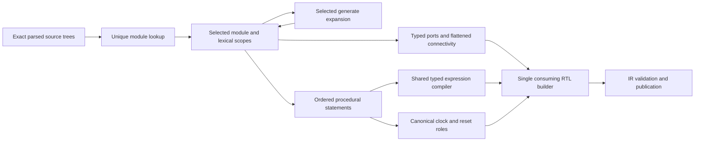

# ProgramElaboration

## Purpose and Scope

Compose selected modules, scopes and typed procedural programs into validated
ElaboratedRTL. Parent: [SystemVerilogFrontend](../DESIGN.md). No children.
Source acquisition/preprocessing and host persistence are outside this component.

## Responsibilities and Boundaries

Own whole-program subset admission, exact module/port matching, selected generate
expansion, signal allocation, procedural statement construction and event roles.
Use verified constant/control/expression contracts; do not interpret string operators
or execute technology mapping. Caller supplies explicit syntax trees, top name,
RTL table capacities and nesting admission. A successful result passes IR validation.

## Related Designs

| Design | Relationship | Contract Used | Summary | Cautions |
|---|---|---|---|---|
| [Frontend](../DESIGN.md) | parent | source composition | portable processing | preprocessing is a separate owner |
| [StaticScopes](../StaticScopes/DESIGN.md) | depends on | exact lexical bindings | constants and runtime names | generated localparams are immutable |
| [StaticControl](../StaticControl/DESIGN.md) | depends on | selected bodies and loop lifecycle | static expansion | actual procedural control writes must reach resume |
| [Expressions](../ExpressionResolution/DESIGN.md) | depends on | explicitly sized RTL | expression meaning | assignment conversion preserves RHS signedness |
| [Instances](../InstanceParameters/DESIGN.md) | depends on | contextual overrides | child parameter values | exact module/source spelling |
| [ResolvedRTL](../../LogicIR/ResolvedRTL/DESIGN.md) | depends on | noncopyable builder and validator | publication | no successful partially built design |
| [ProceduralLowering](../../../../LogicEngine/Sources/LogicLowering/ProceduralLowering/DESIGN.md) | used by | ordered programs and explicit controls | word conversion | lowering proves completeness/race/state constraints |

## Architecture

## Contracts and Invariants

Module names are unique across the supplied trees. Instantiation matches exact
source spelling, retains each instance's parameter environment, and rejects
recursive module ancestry. IDs are deterministic checked counters distinct from
dense indexes. Only top ports are public RTL ports. Port connections are ordinary
typed assignments; equal typed input identifiers may share a signal, including
canonical clock/reset reads. Missing input bindings, mixed named/ordered lists,
unknown/duplicate ports and nonassignable output connections fail at source.
Inout resolution is outside the binary single-driver profile and is refused.
Procedural destinations must be variables. Output ports with an explicit data
type or explicit var storage are variables unless wire storage is specified;
implicit-type output ports are nets.

Blocking/NBA order and first-match case order are preserved. Packed concatenated
and dynamic targets use one RTL assignmentGroup, preserving pre-write RHS/index
sampling and source-order overlap priority. Per-bit address mapping retains each
nested selection boundary; an invalid inner selection cannot wrap into a sibling
packed element. Out-of-range writes affect only valid selected bits. Assignment context
propagates target width but uses RHS signedness. Conditions reduce to unsigned
binary controls. FF sensitivity roles follow dominant reset conditions and edge
polarity, independent of event order. One canonical direct scalar read represents
each clock/reset signal. Ordinary level sensitivity and explicit comb/latch
processes remain distinguishable. Unsupported initial processes fail at source;
constant declaration initial values remain explicit signal state metadata.

Static procedural loops must preserve initialization, body writes, steps and final
externally visible control values. Runtime-dependent iteration counts are refused.
Generated bodies never write their implicit localparam. Procedural local signals
are reused across unrolled visits to one lexical declaration; generate occurrences
have distinct namespaces. Constant declaration/type contexts cannot acquire constant
status merely because a procedural variable is frozen during unrolling.

## State, Ownership, and Lifecycle

One noncopyable run workspace exclusively owns the builder, checked ID/namespace
counters, bounded signal/control caches and module ancestry. Published scopes and
RTL use immutable Sendable storage. Procedural control rebinding constructs new
immutable lexical owners and preserves exact parent/binding correspondence.
Borrowed views stay within synchronous closures; no await, callback or shared state
is introduced. A failure discards the entire candidate; no finish/publication follows.
One pre-admitted three-slot operand buffer is reused when composing expressions;
per-operation temporary operand arrays are not created outside admission.

## Failure, Concurrency, and Constraints

Caller-selected RTL capacities admit workspace tables before allocation. Checked
storage sizes include scratch arrays, retained scopes and builder tables. All
traversal, expansion and expression work uses the same context and cancellation.
Nesting and recursive-module admission bound call-stack depth. Source failures
retain original artifact/range. Kernel resource/control failures remain typed and
are not transformed into empty programs. Table exhaustion follows the builder's
explicit admitted-capacity contract until the public source profile composes it.

The embedding executable must provision a stack qualified for its selected
nesting profile, compiler optimization and target. Managed-storage counters do
not measure the call stack. The package's debug verification profile and actual
stack-capacity counterexample are owned by the [package design](../../../DESIGN.md).
No result is claimed for the SDK's undersized default WASM stack.

## Verification and Change Impact

ProgramElaborationTests owns exact hierarchy/ports, selected generate, ordered
statements, signed assignment/case contexts, static control handoff, FF reset roles,
local lifetime, source refusals and limits/cancellation. Shared probes must execute
actual emitted programs on Native/WASM/Embedded. Source-to-word/bit integration must
also execute ProceduralLowering; syntax/type publication alone cannot prove behavior.
Changes require rechecking the expression/scope owners and lowering's assumptions.
