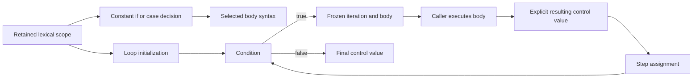

# StaticControl

## Purpose and Scope

Select constant conditional-generate bodies and execute static integral loop
controls. Parent: [SystemVerilogFrontend](../DESIGN.md). No children. Hierarchy,
signal connectivity, body execution and RTL publication are composition-owned.
This design is an implementation contract; completion requires its behavioral gates.

## Responsibilities and Boundaries

Own binary generate decisions, case-wide comparison context and the explicit
loop-control lifecycle. Consume immutable scopes and the single constant evaluator.
The loop interpreter evaluates initialization, condition and step; its caller
executes each body and supplies the resulting control-variable value before resume.
This explicit handoff prevents ignoring body writes. A source elaborator must
establish that supplied values reflect the body's actual admitted semantics before
publishing RTL; a control iterator alone is not source acceptance or termination proof.

## Related Designs

| Design | Relationship | Contract Used | Summary | Cautions |
|---|---|---|---|---|
| [Frontend](../DESIGN.md) | parent | composition | static source decisions | no full RTL claim |
| [StaticScopes](../StaticScopes/DESIGN.md) | depends on | lexical and iteration owners | exact lookup | body values belong to one iteration |
| [Constants](../ConstantEvaluation/DESIGN.md) | depends on | typed contextual expression evaluation | arithmetic authority | common case sign precedes arithmetic |
| [ExecutionControl](../../LogicKernelCore/ExecutionControl/DESIGN.md) | depends on | cumulative resources and control | finite work admission | no counter reset per iteration |

## Architecture

## Contracts and Invariants

Generate-if uses binary truth at the condition's self-determined width. Ordinary
case computes one common maximum width and signedness across selector and every
match before evaluation; operands are signed only if every expression is signed.
This common context propagates into arithmetic before comparison. The first
matching source arm wins, otherwise the default or no body. Every match is typed,
including those after an earlier match. Unselected body declarations are not
elaborated. No X/Z, wildcard matching or dummy selected body is introduced.

Loop initialization resolves its declared/assigned variable, integral type and
source identity. Every step must update that same declaration. Genvar values are
signed 32-bit; explicitly typed procedural variables retain their packed width.
Initialization and assignment use destination width with RHS signedness; compound
updates use the language arithmetic context before assignment. Generate initialization
resolves in the surrounding scope before installing the iteration variable. Inline
procedural declarations shadow surrounding names during initialization; an unavailable
self value fails. Generated bodies cannot change the yielded genvar value; procedural
bodies may supply their statically evaluated control update.
External-variable controls resolve by declaration identity in the retained scope.
The lifecycle is prepared -> yielded -> yielded/finished, with explicit body-value
handoff between yields. Invalid ordering, foreign/incorrect-width or nonbinary
values fail. Finished is terminal; failures publish no new iteration and do not
become normal exhaustion. Nontermination is bounded by cumulative expansion/work,
managed storage, cancellation and caller deadlines, never an inferred success.

## State, Ownership, and Lifecycle

Selection scratch and the loop interpreter are noncopyable, run-local owners.
Published iteration values/scopes are immutable Sendable handles. Each iteration
links to its lexical parent rather than the preceding iteration. Caller body
state is outside this component; no callback, await, I/O or shared mutation occurs.
Borrowed source/value views remain within synchronous closures.

## Failure, Concurrency, and Constraints

Checked actual-target strides admit match handles and temporary metadata before
allocation. The same context enters every expression, condition and step. Scratch
releases on all exits; immutable values remain conservatively charged. Source
failures retain original artifact/range; resource, cancellation and deadline stay
distinct. Targets share source and synchronization contracts; no target-specific
raw-state fallback is allowed.

## Verification and Change Impact

[StaticControlTests](../../../Tests/LogicDesignTests/StaticControlTests.swift) covers case-wide unsigned arithmetic, declaration order and
first-match/default decisions, unselected invalid bodies, positive/negative/wide
controls, compound updates, same-declaration target enforcement, explicit body
updates, lifecycle failures, nontermination/cancellation and source/resource errors.
Native and both matching WASM SDKs compile/link/run the actual controls via the shared StaticControlProbe.
Frontend publication must additionally verify body-control handoff and complete
source-to-RTL semantics; these lower tests cannot replace that integration gate.

Program composition may refresh a procedural loop's parent after body execution.
The replacement must retain the exact lexical identity and parameter binding owner;
foreign sibling iterations cannot alter the loop environment. Generate controls
remain immutable and never use this procedural rebinding path.
