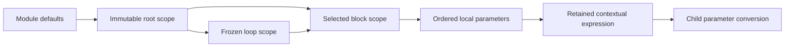

# StaticScopes

## Purpose and Scope

Bind immutable constant and explicitly typed signal environments for selected lexical blocks and frozen
loop iterations. Parent: [SystemVerilogFrontend](../DESIGN.md). No children.
Selection, iteration control/unrolling, runtime signal binding and RTL publication
belong to subsequent semantic elaboration.

## Responsibilities and Boundaries

Own exact lexical containment, nearest-name shadowing, ordered local constants and
source identity. Consume ConstantEvaluation for all width/sign/packed arithmetic.
A scope represents one module instance and one selected lexical path. An iteration
scope freezes the resolved loop declaration at a supplied, exactly typed binary value;
it does not prove termination or treat an arbitrary runtime assignment as constant.

## Related Designs

| Design | Relationship | Contract Used | Summary | Cautions |
|---|---|---|---|---|
| [Frontend](../DESIGN.md) | parent | synchronous composition | selected scope preparation | no complete frontend claim |
| [Syntax](../SyntaxParsing/DESIGN.md) | depends on | immutable nodes and source ranges | lexical ownership | symbols only within this owner |
| [Constants](../ConstantEvaluation/DESIGN.md) | coordinates with | expression typing/evaluation | single arithmetic authority | scope is retained in expression handles |
| [StaticControl](../StaticControl/DESIGN.md) | used by | resolved loop declaration and frozen values | control execution | binding does not prove body semantics |
| [Instances](../InstanceParameters/DESIGN.md) | used by | contextual overrides | child conversion | scoped instance must belong directly to scope |
| [ExecutionControl](../../LogicKernelCore/ExecutionControl/DESIGN.md) | depends on | cumulative budgets | bounded scans and scratch | no per-scope reset |

## Architecture

## Contracts and Invariants

Only direct lexical children may be entered. Conditional-generate bodies own
implicit scopes even without explicit begin/end, except a directly nested
conditional generate without begin/end (IEEE 1800 section 27.5), which shares the
enclosing scope. Terminal branches of such a chain are direct lexical children;
all intermediate conditions resolve in the enclosing scope. Expression and instance handles must
belong to the supplied scope, excluding nested blocks and loop scopes. Scope
construction scans flat syntax using exact byte containment and postorder node
identity; expression lookup uses only interned symbol indexes and local entries.
The nearest declaration shadows its ancestors even when it is a runtime signal,
instance, scope label, uninitialized genvar, or not-yet-evaluated local parameter.
Such a name is not silently replaced by a module parameter. Local constants resolve
in source declaration order; self/forward references fail at the identifier.
Duplicate declarations fail, except the separate header/body declarations of the
same non-ANSI port, which denote one signal, and the same label in mutually
exclusive conditional-generate branches. Simultaneous duplicate labels fail. Module parameter declarations retain
binding/default authority. Nested parameter declarations are not override targets.
Loop declaration resolution owns the exact inline or nearest externally declared
control identity and packed type. Generate controls require genvar; procedural
controls require an explicit integral variable. Frozen values have exact assignment
width; genvar is signed 32-bit. A generated body owns an implicit localparam with the
control name in its own declaration scope. It cannot be redeclared in that body or
assigned as a nested external genvar. A fresh inline genvar in a nested loop may
shadow it. The frozen binding retains this role independently of original syntax.
External assignment targets must be plain identifiers
bound to the nearest declaration. This only binds a supplied value; StaticControl
owns initialization, step, body handoff and termination. X/Z values fail synthesis
constant admission.
Selected child scopes and sibling iterations have distinct immutable owners; a
new iteration links to the lexical parent, never the preceding iteration.

## State, Ownership, and Lifecycle

A noncopyable evaluator constructs each scope's local entry array, then consumes
it into immutable final Sendable storage. A scope retains its parent, defaults and
source owner. Parent chains follow lexical nesting only. Dense immutable module
values are shared rather than copied per iteration. Scoped Span access never
escapes. Temporary traversal/metadata arrays release on success and failure;
published entries, scope boundaries and value planes stay conservatively charged.
No shared mutable state or target-specific synchronization is introduced.

## Failure, Concurrency, and Constraints

Checked actual-target strides admit entry/boundary capacity and evaluator scratch
before allocation. Syntax scans, lexical lookup, parameter evaluation and iteration
binding consume the same context's work/expansion budget and cancellation control.
Invalid owner/containment is invalidInput; unresolved, duplicate and nonconstant
names preserve artifact/byte ranges. A failed scope is never published. Managed
payload accounting excludes allocator metadata/RSS; no zero-copy/performance claim.

## Verification and Change Impact

[StaticScopeTests](../../../Tests/LogicDesignTests/StaticScopeTests.swift) owns
nested shadowing, runtime-name refusal, earlier/local/forward declarations,
selected branch isolation, iteration identity/type, contextual child carry,
source location, resource/cancellation and immutable owner retention. Shared
runtime probes exercise the same scope and child-context operations on Native,
ordinary WASM and Embedded WASM. Changes require rechecking constants and instance
composition. Full source elaboration and loop termination remain separate gates.

Runtime signal bindings retain the same exact lexical owner and parent chain.
Each direct runtime name is bound once with its exact declaration type/dimensions
and dense RTL signal index. Separate non-ANSI port declarations share one binding.
Constants and frozen controls retain precedence; labels/instances block names.
A binding cannot change a declaration type or enter a foreign scope. Complete
frontend composition owns actual builder signal/direction/connectivity admission.

Procedural control updates replace only an available frozen variable entry, preserving
its exact type, declaration identity and immutable parent chain. Generated constants
and parameter entries cannot be written. Signal bindings retain their corresponding
new constant owner after rebinding; no published storage is mutated. ProgramElaboration
owns statement ordering and runtime-branch agreement before accepting static expansion.

A scope has an immutable lexical identity retained across control-value rebinding.
Fresh entries/iterations receive fresh identities. StaticControl may refresh its
parent values only from a replacement with the original exact lexical identity.
