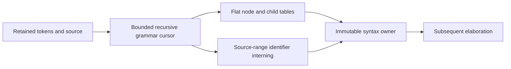

# SyntaxParsing

## Purpose and Scope

Parse the initial packed-vector language grammar into a flat, source-retaining
syntax tree. Parent: [SystemVerilogFrontend](../DESIGN.md). No children. This is
a package-internal input to elaboration, not a public synthesis admission API.

## Responsibilities and Boundaries

Own grammar, precedence, ordered child lists and source ranges. Retain unresolved
parameter expressions, declarations, hierarchy bindings, generate conditions,
procedural order and event terms. Elaboration owns symbol scopes, constant
evaluation, widths, signedness, driver admission and trigger-role resolution.
Syntax success is neither ElaboratedRTL publication nor synthesis acceptance.

## Related Designs

| Design | Relationship | Contract Used | Summary | Cautions |
|---|---|---|---|---|
| [SystemVerilogFrontend](../DESIGN.md) | parent | portable processing | composition | no host parser fallback |
| [LexicalAnalysis](../LexicalAnalysis/DESIGN.md) | depends on | immutable token/source owner | exact byte offsets | no token spelling copies |
| [ExecutionControl](../../LogicKernelCore/ExecutionControl/DESIGN.md) | depends on | cumulative context | admission and cancellation | no budget reset |

## Architecture

## Contracts and Invariants

Nodes contain indices into earlier completed nodes; variable child lists occupy
exact contiguous ranges. All ranges refer to the retained source. Identifier
interning compares exact UTF-8 bytes after removing an escaped identifier's
leading backslash; fingerprints only select collision chains. Unicode escaped
names and keyword escaped names remain legal. Keywords cannot become ordinary
identifiers. Unescaped dollar-prefixed system names cannot become ordinary
identifiers; supported system casts are parsed through their explicit expression
grammar. Dollar characters within simple identifiers and escaped dollar-prefixed
identifiers retain their ordinary name semantics. Mismatched module, procedural
block and generate-block end labels report the offending label's source range.
Module port and parameter inheritance is represented explicitly. Net/variable
qualifiers and explicit versus implicit data types remain distinct so elaboration
can apply port-kind defaults without inferring them from a flattened logic type.

Expressions use SystemVerilog precedence and left associativity; conditional
expressions associate right. Lvalues use a separate grammar so nonblocking `<=`
is never consumed as relational comparison. Static and indexed selections,
concatenation, repetition, blocking/NBA, ordinary case, loops and conditional/loop/case generate retain
their original order. Division, remainder, power, wildcard case and unsupported
language categories fail with exact artifact/range diagnostics. Event order is
retained without selecting a clock or reset by position.

Grammar cross-check: [slang's published SystemVerilog grammar](https://github.com/MikePopoloski/slang/blob/master/docs/grammar.md).
It is a reference, not an execution backend.

## State, Ownership, and Lifecycle

One noncopyable parser owns cursor, flat mutable tables and symbol chains. The
published Sendable value retains immutable final storage and the source owner.
No Span escapes or survives suspension. Temporary linked child lists allow nested
lists without recursive AST ownership or per-list arrays. No shared mutable state
or target-dependent isolation is introduced.

## Failure, Concurrency, and Constraints

The public immutable SystemVerilogSyntaxLimits value owns positive node, child,
symbol and nesting capacities used by frontend composition. Callers choose them. Fixed-capacity
table storage is admitted before allocation, including simultaneous scratch and
published child tables. The explicit nesting limit bounds recursive grammar calls;
identifier scratch payload counts each UInt64 hash key and both Int values
(chain link and hash-table head) by its actual target layout. A 32-bit target does
not narrow hash keys for budget accounting. The total is admitted before allocation.
Publication uses a flat ownership graph. Managed bytes are logical payload bytes,
not allocator metadata or process RSS. Every token, comparison byte, node, child
and collision traversal consumes cumulative work/expansion. Failure returns no
partial tree. Preprocessing and semantic resolution remain later composition work.

## Verification and Change Impact

[PortableSyntaxTests](../../../Tests/LogicDesignTests/PortableSyntaxTests.swift)
owns precedence, exact source/identifier retention, ordered process/event/case
and hierarchy/generate grammar, malformed/unsupported rejection and resource
failures. The package probe executes the same parser on Native/WASM/Embedded.
Changes require rechecking elaboration consumers; grammar tests do not establish
arithmetic or event execution semantics.

Module nodes retain whether a parameter port list was written, including an empty `#()`. Later parameter admission uses this syntax fact to distinguish overridable body parameters from body parameters that are implicitly local.

Syntax trees retain [SourceText](../SourceText/DESIGN.md), preserving transformed
symbol bytes separately from exact-artifact origins. Every diagnostic and later
semantic origin must use its range projection.
